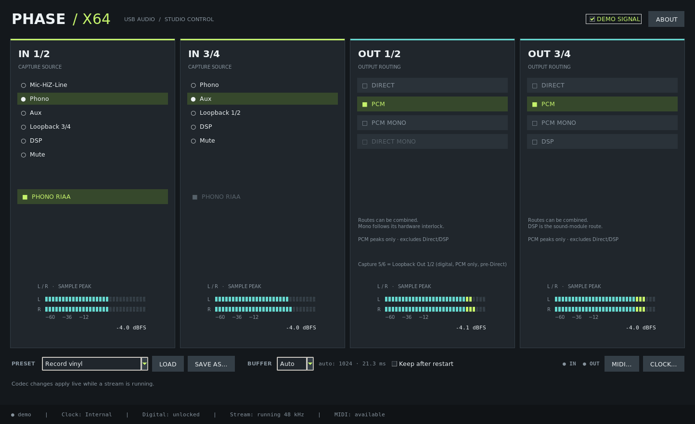
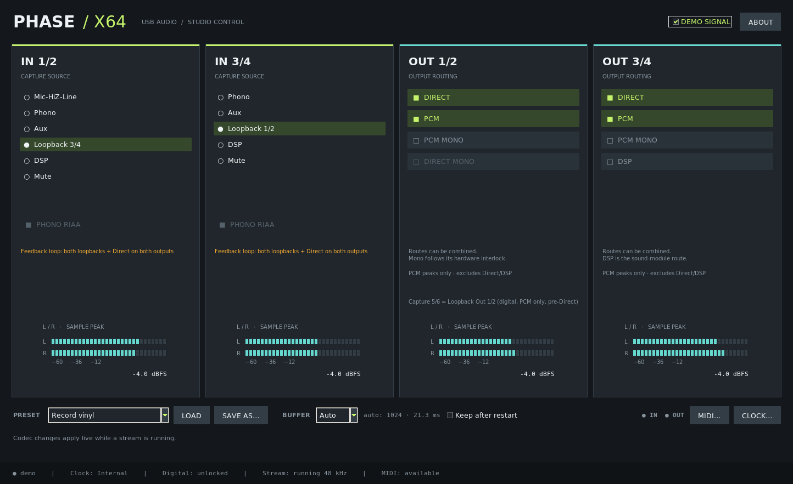
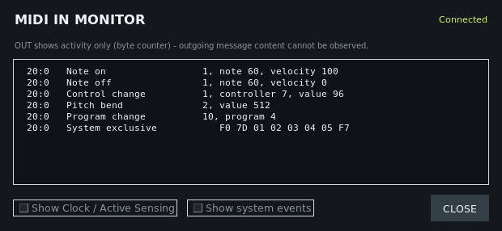
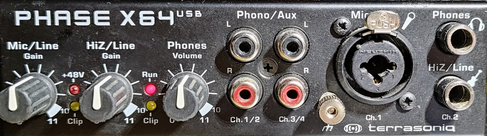
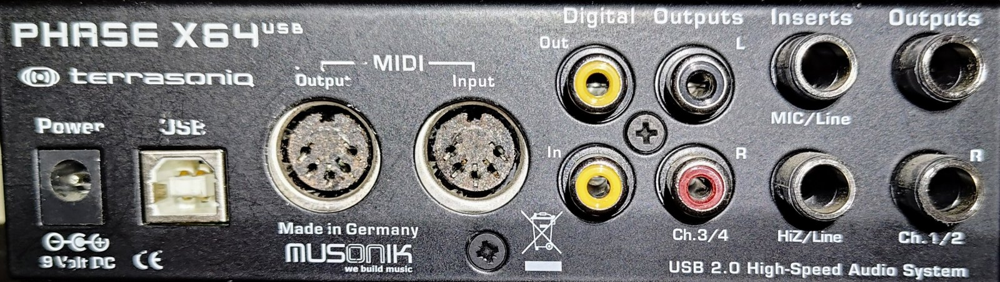
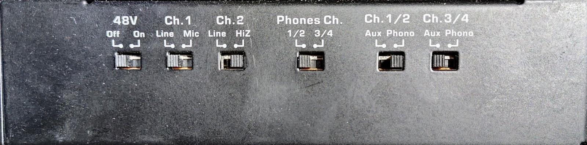

# phasex64-linux

Linux driver and control panel for the PHASE X64 USB audio interface.


[](https://github.com/flarkflarkflark/phasex64-linux/releases)
[](https://github.com/flarkflarkflark/phasex64-linux/actions/workflows/build.yml)

Nederlandse versie: [README.nl.md](README.nl.md) ·
Releases: [all releases](https://github.com/flarkflarkflark/phasex64-linux/releases) ·
Changes: [CHANGELOG.md](CHANGELOG.md)

## What it is

The PHASE X64 USB has no class-compliant USB audio mode, so Linux's
standard `snd-usb-audio` driver can't use it. This project provides:

- **`snd-usb-phasex64`** - an ALSA kernel driver, built and kept up to
  date across kernel updates with DKMS.
- **`phasex64-panel`** - a control panel (Python/Tk) for routing, capture
  sources, phono RIAA, meters, MIDI activity and PipeWire's buffer size.
  It doesn't depend on any particular desktop environment.
- **`phasex64-wireplumber`** (optional) - a WirePlumber profile that
  keeps the card on PipeWire's "Pro Audio" profile with native format
  and sample rate, for use with JACK applications such as REAPER.

Also known as / search terms: TerraTec PHASE X64 USB, TerraSoniq PHASE
X64, Musonik PHASE X64, Ploytec chipset, TerraTec Phase X64 Linux
driver. These names are used only to describe which hardware this
works with.

## Status

**v0.9.1, public beta.** Tested on one unit, on two machines (see
[Tested environment](#tested-environment)).

What works:

- Playback, 4 channels (Out 1/2 and Out 3/4), 24 bit.
- Capture, 6 channels: In 1/2, In 3/4, and channels 5/6, a bit-exact
  digital copy of what is sent to Out 1/2 (for recording what you hear).
- Phono inputs with the RIAA equalisation applied in the driver, as the
  Windows driver does.
- Codec and routing changes while a stream is running (applied live,
  with a ~0.3 s gap that keeps the stream's timeline continuous).
- MIDI in and out (5-pin DIN).
- PipeWire, and JACK applications via `pipewire-jack`; bit-exact
  through PipeWire when the card's sink and source volume are at 100 %.
- Buffer sizes down to 64 samples (1.3 ms at 48 kHz).
- Sample rates (playback and capture always share one rate):
  - **48 kHz** - daily use, and the rate of the feature tests since
    driver v0.1.10 (live changes, MIDI, PipeWire/REAPER, buffer sizes).
  - **44.1, 88.2 and 96 kHz** - supported, and tested on hardware once,
    with driver v0.1.10 on 2026-10-14 (direct ALSA, no PipeWire): 12 s
    of playback and capture at once, a 1 kHz tone through an analog
    loopback, at each rate - real time, the rate read back from the
    device matched, no errors - plus switching 48 → 44.1 → 96 → 48 kHz
    without replugging. 44.1 kHz was also used for the capture 5/6
    bit-exactness test (2026-10-16). Not re-tested since then, and not
    through PipeWire or REAPER.
- Clock source: internal, or locked to the S/PDIF input.

### Tested environment

On hardware (one unit):

- **Machine 1** (everything above): Arch Linux, kernel 7.2.x, PipeWire
  1.6.x, WirePlumber 0.5.x, REAPER 7.82 via `pipewire-jack`.
- **Machine 2:** EndeavourOS, kernel 6.18 LTS (DKMS also built the
  module for 7.2), a different AMD xHCI USB controller, the unit
  connected through a USB hub next to other USB audio devices. Playback
  and recording at the same time run stable; the WirePlumber profile
  affects only the PHASE X64, not the other audio devices.

Build-tested in CI on every push, against each distribution's own
kernel headers (no hardware involved;
[build status](https://github.com/flarkflarkflark/phasex64-linux/actions/workflows/build.yml)):

| Distribution | Kernel |
|---|---|
| Ubuntu 22.04 | 5.15 |
| Ubuntu 24.04 | 6.8 |
| Debian 13 (stable) | 6.12 |
| Arch Linux | 7.2 |
| Fedora 44 | 7.2 |

(Kernel versions as of 2026-10-22; CI always uses the distributions'
current headers.)

## Installation

Pick one of the four ways below. In every case DKMS builds the driver on
your own machine, for your kernel - no prebuilt kernel module is
shipped - so the kernel headers for your kernel have to be installed.

<a id="quick-start-arch-linux--manjaro"></a>

### 1. Arch Linux, Manjaro, EndeavourOS: release packages

Download the driver and panel packages from the
[latest release](https://github.com/flarkflarkflark/phasex64-linux/releases),
check them against `SHA256SUMS`, and install them:

```sh
sudo pacman -S --needed linux-headers   # the headers for your kernel, see below
v=0.9.1
base=https://github.com/flarkflarkflark/phasex64-linux/releases/download/v$v
curl -L --remote-name-all "$base/SHA256SUMS" \
  "$base/snd-usb-phasex64-dkms-$v-1-any.pkg.tar.zst" \
  "$base/phasex64-panel-$v-1-any.pkg.tar.zst"
sha256sum -c --ignore-missing SHA256SUMS   # every file must say "OK"
sudo pacman -U "snd-usb-phasex64-dkms-$v-1-any.pkg.tar.zst" \
  "phasex64-panel-$v-1-any.pkg.tar.zst"
```

- Use the headers package of your kernel: `linux-lts-headers`,
  `linux-zen-headers`, `linuxXYZ-headers` on Manjaro, ... `dkms` comes in
  as a dependency.
- Download first, then install the local files: the packages aren't
  GPG-signed, and with Arch's default settings `pacman -U` refuses
  unsigned packages given as a URL (it accepts them as local files).
  `SHA256SUMS` is the check instead.

Then unplug and replug the card, or load the module directly, and start
the panel from the application menu ("PHASE X64 USB") or with
`phasex64-panel`:

```sh
sudo modprobe snd-usb-phasex64
cat /sys/module/snd_usb_phasex64/version   # 0.9.1
```

Optional, for JACK/REAPER use: the WirePlumber profile. Read
[PipeWire / JACK](linux/README.md#pipewire--jack) first - it applies to
every user on the machine (it only changes how the PHASE X64 is
handled). In the same shell as above:

```sh
curl -L -O "$base/phasex64-wireplumber-$v-1-any.pkg.tar.zst"
sha256sum -c --ignore-missing SHA256SUMS
sudo pacman -U "phasex64-wireplumber-$v-1-any.pkg.tar.zst"
systemctl --user restart wireplumber
```

To update, do the same with the newer version; to remove:
`sudo pacman -R snd-usb-phasex64-dkms phasex64-panel phasex64-wireplumber`.

### 2. AUR

`snd-usb-phasex64-dkms`, `phasex64-panel` and `phasex64-wireplumber`
(package base `phasex64`) - coming soon.

<a id="other-distributions"></a>

### 3. Any other distribution: release tarball + DKMS

```sh
v=0.9.1
base=https://github.com/flarkflarkflark/phasex64-linux/releases/download/v$v
curl -L --remote-name-all "$base/SHA256SUMS" "$base/phasex64-linux-$v.tar.gz"
sha256sum -c --ignore-missing SHA256SUMS   # must say "OK"
tar xzf "phasex64-linux-$v.tar.gz"
cd "phasex64-linux-$v"
scripts/install-dkms.sh --dry-run   # check prerequisites, show the steps
sudo scripts/install-dkms.sh
sudo modprobe snd-usb-phasex64      # or unplug and replug the card
```

The script checks for dkms, make, gcc and the headers of your running
kernel, and names the packages to install for apt, dnf, zypper or pacman
if something is missing. DKMS rebuilds the module after every kernel
update. Remove it with `sudo scripts/uninstall-dkms.sh`. Details:
[Installing on other distributions](linux/README.md#installing-on-other-distributions).

**Secure Boot:** with Secure Boot on, only signed modules load; an
unsigned one fails with `Key was rejected by service`. DKMS signs the
module, and its key has to be enrolled once (MOK) at a reboot - see
[Secure Boot](linux/README.md#secure-boot). Check with
`mokutil --sb-state`.

**Control panel:** install its dependencies, then run
`linux/phasex64-panel/phasex64-panel` from the extracted directory
([menu entry and details](linux/README.md#control-panel-without-a-package)).

| Distribution | Required | Optional: BUFFER control |
|---|---|---|
| Debian, Ubuntu | `python3 python3-tk alsa-utils` | `pipewire-bin` |
| Fedora | `python3 python3-tkinter alsa-utils` | `pipewire-utils` |
| openSUSE | `python3 python3-tk alsa-utils` | `pipewire-tools` |
| Arch | `python tk alsa-utils` | `pipewire` |

`setpriv` from util-linux (installed almost everywhere) is used too if
present.

### 4. From source (developers)

```sh
git clone https://github.com/flarkflarkflark/phasex64-linux.git
cd phasex64-linux
```

Then, on Arch-based distributions, build the packages yourself
(`sudo pacman -S --needed base-devel dkms linux-headers` first):

```sh
cd linux
makepkg -s
sudo pacman -U snd-usb-phasex64-dkms-*.pkg.tar.zst phasex64-panel-*.pkg.tar.zst
```

or, anywhere, `sudo scripts/install-dkms.sh` from the checkout, or build
the module by hand with `make` - see
[Installing on Arch Linux](linux/README.md#installing-on-arch-linux).
The full manual is [linux/README.md](linux/README.md).

## Screenshots

All screenshots are from the panel's demo mode (no device connected,
no vendor artwork).



*Main window, "Record vinyl" preset loaded.*



*Loopback sources with the analog feedback-loop warning.*



*MIDI IN monitor (example messages).*


*Buffer control: PipeWire's buffer size, with the latency at the current
sample rate.*

## Hardware

A USB 2.0 interface released around 2010-2011 under the TerraSoniq
name by Musonik, which had distributed TerraTec's Producer range
(including the PHASE series) and continued it under its own brand; the
vendor's own text presented it as the successor of the PHASE 26 USB
([KVR Audio forum thread, 2011](https://www.kvraudio.com/forum/viewtopic.php?t=309484)).
It is no longer sold
([Musikhaus Korn product listing](https://www.musikhaus-korn.de/en/terrasoniq-phase-x64-usb/pd/36185)).
Listed features: 24 bit / 96 kHz, a mic/line combo input with 48 V
phantom power, a Hi-Z instrument input, two inserts, phono/aux inputs,
coaxial S/PDIF in and out, a headphone output, MIDI in and out, and
power from USB or a separate supply (same listing;
[Audiofanzine product page and user review](https://en.audiofanzine.com/usb-interface/terratec/terrasoniq-phase-x64-usb/)).

Inside, as seen from the driver: a Ploytec USB controller (USB ID
`0a4a:5b01`) and two Wolfson WM8776 codecs.

Connections on the unit used for this project:

- **Front:** phono/aux RCA inputs for Ch.1/2 and Ch.3/4; Ch.1 mic combo
  socket (XLR + 6.3 mm jack) with Mic/Line gain knob, +48 V and clip
  LEDs; Ch.2 Hi-Z/Line jack with gain knob and clip LED; headphone jack
  with volume knob; ground terminal (⏚) between the RCA inputs and the
  Ch.1 combo socket; "Run" LED next to the Hi-Z gain knob.
- **Rear:** power (9 V DC), USB-B, MIDI out/in, S/PDIF (coaxial) out/in,
  Out 3/4 (RCA), inserts for Ch.1 (Mic/Line) and Ch.2 (Hi-Z/Line),
  Out 1/2 (6.3 mm jacks).
- **Side switches:** 48 V on/off, Ch.1 Line/Mic, Ch.2 Line/Hi-Z, headphone
  source 1/2 or 3/4, Ch.1/2 Aux/Phono, Ch.3/4 Aux/Phono. These are
  hardware-only; the driver can't read or set them.



*Front. The ground terminal (⏚) at the bottom, between the RCA inputs
and the Ch.1 combo socket, takes the turntable's ground wire; the red
"Run" LED means connected over USB / powered.*



*Rear. Power, USB, MIDI, S/PDIF, Out 3/4, inserts, Out 1/2.*



*Side. The hardware-only switches: 48 V, Ch.1 Line/Mic, Ch.2 Line/Hi-Z,
headphone source, Ch.1/2 and Ch.3/4 Aux/Phono.*

Photos: the author's own unit, CC BY 4.0 (see
[docs/hardware/](docs/hardware/README.md)).

**Turntable:** connect the turntable's ground wire to the ground
terminal (⏚) on the front, between the RCA inputs and the Ch.1 combo
socket, to avoid hum.

**"Run" LED:** means the unit is connected over USB and powered. Checked
on hardware: it stays lit with the driver loaded while no PCM stream is
running (both PCMs closed, PipeWire nodes suspended), so it doesn't show
whether audio is streaming.

### Measured with this driver

- **Front inputs:** Ch.1 arrives on the left channel of In 1/2, Ch.2 on
  the right, both mono. The Ch.1 switch selects the connector: Mic uses
  the XLR part, Line the jack part. 48 V is only on the XLR pin. Gain is
  analog, set with the knobs on the unit; the clip LED lights at 0 dBFS
  at the converter. Mic gain covers about 25 dB, Line about 14 dB, Hi-Z
  at least 30 dB. Details:
  [Front inputs](linux/README.md#front-inputs-mic--hi-z--line).
- **Direct monitoring:** Direct keeps Ch.1 left and Ch.2 right; Direct
  Mono sums both to both sides.
- **Two kinds of loopback:** capture 5/6 is a digital copy of the PCM
  sent to Out 1/2, before any Direct monitoring is mixed in. The
  `Loopback 3/4` / `Loopback 1/2` capture sources record the *other*
  output pair's analog output, including Direct. Details:
  [Capture channel layout](linux/README.md#capture-channel-layout).
- **Buffer sizes:** 64, 128, 256 and 1024 samples run stable with
  playback and recording at the same time; a live change can cause one
  short click.
- **Latency:** at 64 samples, an analog loopback recording came back
  about 54 samples (≈1.1 ms) later than REAPER's own compensation
  accounts for. This is a first, approximate measurement. Details:
  [Buffer size and latency](linux/README.md#buffer-size-and-latency).
- **MIDI needs an audio stream:** the device firmware only passes MIDI
  while an audio stream is running (a capture stream alone is enough).
  The driver's MIDI code doesn't depend on it; the device does.

## Known limitations

- **MIDI only while audio streams.** See "Measured with this driver";
  with the WirePlumber profile the stream stays open, so MIDI keeps
  working.
- **Side switches must match.** The Aux/Phono switch for Ch.1/2 and
  Ch.3/4 has to match the capture source chosen in the panel; the driver
  can't read the switches.
- **A locked S/PDIF input sets the clock.** When the S/PDIF input is
  locked, the device follows its clock even with the internal clock
  selected. The panel shows the lock state.
- **S/PDIF audio** (recording from or playing to S/PDIF) hasn't been
  characterised yet.
- **Gain and 48 V are analog,** on the unit itself; no software control.
- **`status read failed: bRequest=0x49`** in `dmesg` (debug level only)
  is expected and harmless - see
  [If something doesn't work](linux/README.md#if-something-doesnt-work).
- **The original Windows panel skin is optional** and has to be imported
  from your own copy of the vendor driver package; it isn't included
  here.

## Disclaimer

This project is not affiliated with or endorsed by TerraTec, TerraSoniq,
Musonik or Ploytec. All trademarks belong to their owners. The driver
was developed by independent reverse engineering for interoperability;
no vendor code or firmware is included. It is an experimental kernel
module and comes with no warranty (see the GPL-2.0 licence).

## Acknowledgements

- The ALSA and Linux kernel developers.
- The original engineers of the PHASE X64 and its firmware.
- Marcel Bierling, for the [Ozzy](https://github.com/mischa85/Ozzy)
  driver for Ploytec interfaces (MIT), an early reference for the
  protocol.
- The users and reviewers whose published reviews and discussions
  informed the hardware overview:
  [Audiofanzine](https://en.audiofanzine.com/usb-interface/terratec/terrasoniq-phase-x64-usb/user_reviews/),
  the [KVR Audio forum thread](https://www.kvraudio.com/forum/viewtopic.php?t=309484).
- AI agents that contributed:
  - Claude by Anthropic (Opus and Sonnet) - analysis, driver and panel
    implementation, reviews.
  - OpenAI Codex - the first implementation of the MIDI monitor.
- Project lead: Flark / flarkAUDIO (GitHub
  [flarkflarkflark](https://github.com/flarkflarkflark)) - direction and
  all hardware testing.

Built by loopback-coding: AI-assisted, human-directed, hardware-verified.
Every change went out, came back through real hardware, and was measured
before it counted.

## Licence

GPL-2.0-only - see [LICENSE](LICENSE) - except the photos in
[docs/hardware/](docs/hardware/README.md), which are © 2026
flarkflarkflark, licensed
[CC BY 4.0](https://creativecommons.org/licenses/by/4.0/). The
reverse-engineering notes are in [analysis/](analysis/README.md).
